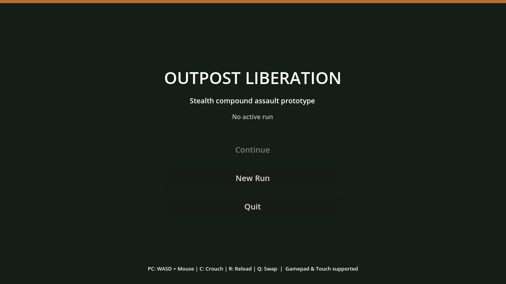
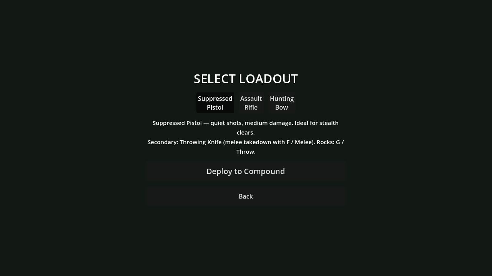
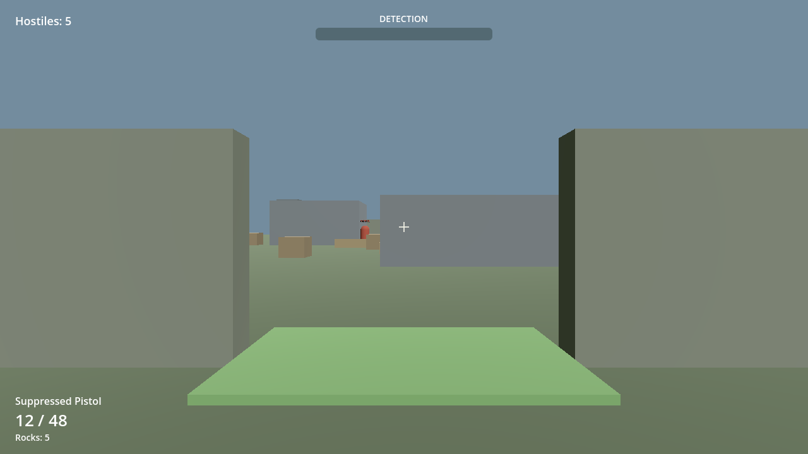
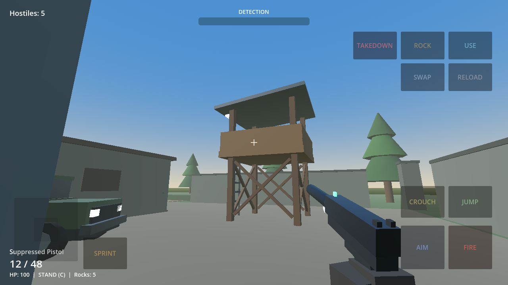

# Outpost Liberation

Godot **4.3** first-person stealth shooter prototype inspired by Far Cry 5 outpost liberation. Approach a greybox compound, clear guards (ideally undetected), and liberate the outpost. Runs on **PC** (Windows / Linux / macOS), **mobile** (Android / iOS), and in the **browser** with the **GL Compatibility** renderer and on-screen touch controls.

## Play in browser

**[Play Outpost Liberation](https://continuitydev.github.io/Farsigh/)** — no download required (GitHub Pages Web export, no threads so it works without COOP/COEP headers).

On desktop browsers: click the game once to capture the mouse. On phones: touch controls appear automatically.

## Requirements

- [Godot 4.3+](https://godotengine.org/download) (4.3 or 4.x compatible)
- Export templates matching your editor version (Project → Export)

## How to run

1. Open this folder in Godot (`project.godot`).
2. Press **F5** (or Play). Main menu loads first.
3. Choose **New Run** → pick a loadout → **Deploy to Compound**.

### Controls (PC)

| Action | Keyboard / Mouse | Gamepad |
|--------|------------------|---------|
| Move | WASD | Left stick |
| Look | Mouse | Right stick |
| Jump | Space | A |
| Sprint | Shift | L3 |
| Crouch | Ctrl | B |
| Fire | LMB | RT / RB |
| Aim (zoom) | RMB | LT |
| Reload | R | Y |
| Interact / pick up body / disable alarm | E | X |
| Melee takedown | F | R3 |
| Throw rock (distraction) | G | Select / Back |
| Switch weapon | 1 / 2 or Q | D-pad right |
| Drop body | X | — |
| Pause | Esc | Start |

### Controls (Mobile / mobile browsers)

Touch controls appear automatically on native mobile and on web builds when a touchscreen is available:

- **Left virtual stick** — move  
- **Right-side swipe** — look  
- Buttons — Fire, Aim, Crouch, Sprint, Jump, Use, Rock, Reload, Swap, Takedown  

Menus use large touch-friendly buttons. Display stretch mode is `canvas_items` + `expand` for phones and tablets.

## Gameplay loop

1. Select primary: **suppressed pistol**, **loud rifle**, or **silent bow** (knife always secondary).
2. Infiltrate via south or west entrance. Crouch to reduce visibility and footstep noise.
3. Guards **patrol → suspicious → alert/search → combat**. Vision uses distance, crouch, and LOS; hearing reacts to gunshots, footsteps, and impacts.
4. Guards spot **bodies** and **suspicious items** (arrows, knives, rocks). Hide bodies with **Use**.
5. Disable the **alarm panel** before a guard reaches it, or reinforcements spawn.
6. Eliminate all guards → outpost is **Liberated** and saved to disk (`user://outpost_save.json`).
7. **Continue** keeps liberation; **New Run** resets progress.

## Project structure

```
scripts/
  ai/           Guard state machine, vision, hearing reactions
  combat/       HitZone body-part damage (HEAD one-shots)
  enemies/      GuardVisual placeholder + AnimationPlayer hooks
  player/       FPS controller (keyboard / gamepad / touch)
  weapons/      WeaponData, WeaponManager, ViewmodelRig slots
  systems/      GameState, SaveManager, NoiseBus, TouchInput, Alarm, OutpostManager
  items/        Bodies, rocks, arrows, knives
  ui/           Main menu, loadout, HUD, touch controls
  levels/       Greybox compound builder
scenes/
  levels/outpost.tscn   Playable compound
  player/ enemies/ items/ ui/
export_presets.cfg      Windows, Linux, macOS, Android, iOS, Web
docs/                   GitHub Pages web build + screenshots/
```

### Combat hit zones

Guards expose `HitZones/Head|Torso|Limbs` (`HitZone` areas on physics layer `hitboxes`). Weapons raycast/probe those areas:

| Zone | Effect |
|------|--------|
| HEAD | Always lethal (one-shot) |
| TORSO | Full weapon damage |
| LIMBS | ~55% damage |

### Art-pass hooks (placeholders only)

- **Viewmodels:** `Player/Head/Camera3D/Viewmodels` (`ViewmodelRig`) with `PistolSlot`, `RifleSlot`, `BowSlot`, `KnifeSlot` — swap in real meshes later.
- **Guards:** `Guard/Visual` (`GuardVisual` + `AnimationPlayer`) expects `idle` / `walk` / `alert` / `combat` / `death` — replace `PlaceholderMesh` with a character scene without changing AI.

### Extending with more compounds

1. Duplicate `scenes/levels/outpost.tscn` (or build a new greybox under `scripts/levels/`).
2. Give the root `OutpostManager` a unique `outpost_id` / display name.
3. Add patrol `Marker3D`s, guards with `patrol_path` + `alarm_path`, and an `AlarmPanel`.
4. Register the id in `GameState.outposts` (or let the manager create it on first clear).
5. Add a menu entry that `change_scene_to_file`s your new scene after loadout.

Systems stay modular: AI listens to `NoiseBus`, persistence goes through `SaveManager`, weapons only care about `WeaponData` noise/damage.

## Exporting

Presets live in `export_presets.cfg` (including **Web** with `variant/thread_support=false` for GitHub Pages). Install matching **export templates** in the editor first.

### Web / GitHub Pages

Live game: **https://continuitydev.github.io/Farsigh/**

Every push to `main` runs [`.github/workflows/deploy-web.yml`](.github/workflows/deploy-web.yml): it downloads Godot 4.3 + export templates, exports a **no-threads** Web build (`variant/thread_support=false`), and publishes it into `docs/` (this matches the repo’s current Pages source: **Deploy from a branch → `main` → `/docs`**). The workflow also attempts `actions/upload-pages-artifact` + `actions/deploy-pages` for when Pages is switched to Actions.

**Preferred (optional) owner setting:** Repo → **Settings → Pages → Build and deployment → Source: GitHub Actions**. Until that is set, branch `/docs` publishing is the path that works.

Local Web export:

```bash
mkdir -p build/web
godot --headless --path . --export-release "Web" build/web/index.html
# Serve build/web over HTTP (not file://)
```

### Windows / Linux / macOS

1. Project → Export → select **Windows Desktop**, **Linux/X11**, or **macOS**.
2. Choose a path under `build/` (presets already point there).
3. Export Project. Embed PCK is enabled for a single binary/app bundle.

### Android (debug APK)

1. Editor → Editor Settings → Export → Android: set **Debug Keystore** (Godot can create one) and JDK / SDK paths as required by your Godot version.
2. Install Android build template / one-click install if prompted.
3. Project → Export → **Android** → Export Project → `build/android/OutpostLiberation.debug.apk`.
4. Install: `adb install -r build/android/OutpostLiberation.debug.apk`  
   Or copy the APK to the device and open it (allow unknown sources).

The project uses the **GL Compatibility** rendering method (OpenGL / OpenGL ES) so the same project runs on desktop GPUs without Vulkan and on phones. ETC2/ASTC-friendly import is enabled. Immersive mode is on in the Android preset.

Preview touch controls on desktop: `TOUCH_UI=1 godot --path .`

### iOS

1. Export requires a Mac with Xcode and an Apple Developer team id in the iOS preset.
2. Project → Export → **iOS** → export the Xcode project / IPA.
3. Open in Xcode, set signing team, deploy to a device or Simulator.

## Performance notes

- GL Compatibility renderer, no MSAA, shadows off on the key light, primitive meshes only.
- Avoid adding heavy GI / SSAO / glow when targeting phones.
- Prefer one DirectionalLight + soft ambient; keep guard count modest per compound.

## Screenshots

Captured from a running Godot 4.3 session:

| | |
|--|--|
| Main menu |  |
| Loadout select |  |
| Outpost (PC HUD) |  |
| Touch controls |  |

```bash
# Optional automated captures (needs a display; use OpenGL if Vulkan is unavailable)
AUTO_CAPTURE=1 godot --path . --resolution 1280x720 --rendering-driver opengl3
```

## License

Prototype code is free to use and extend for learning and game jams.
