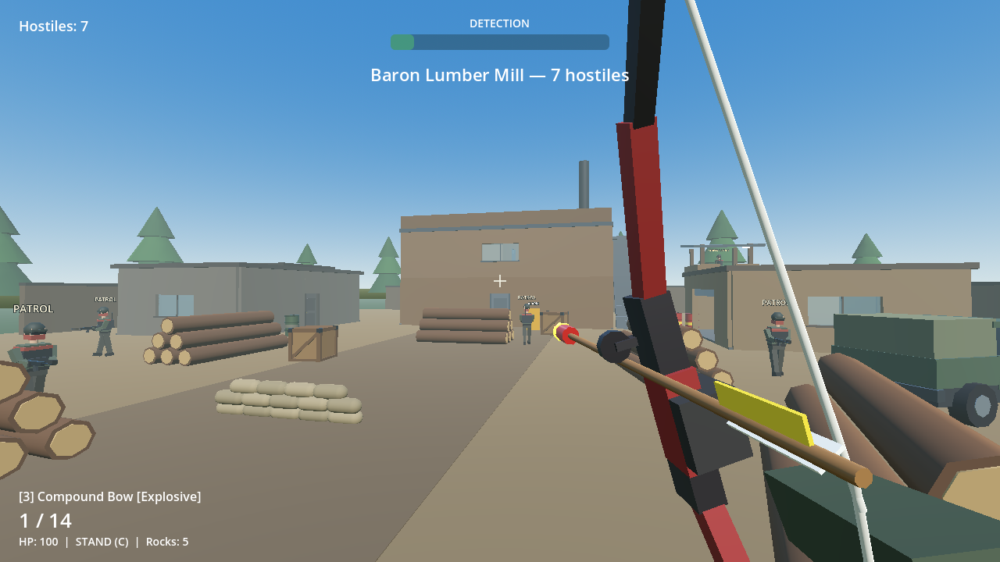
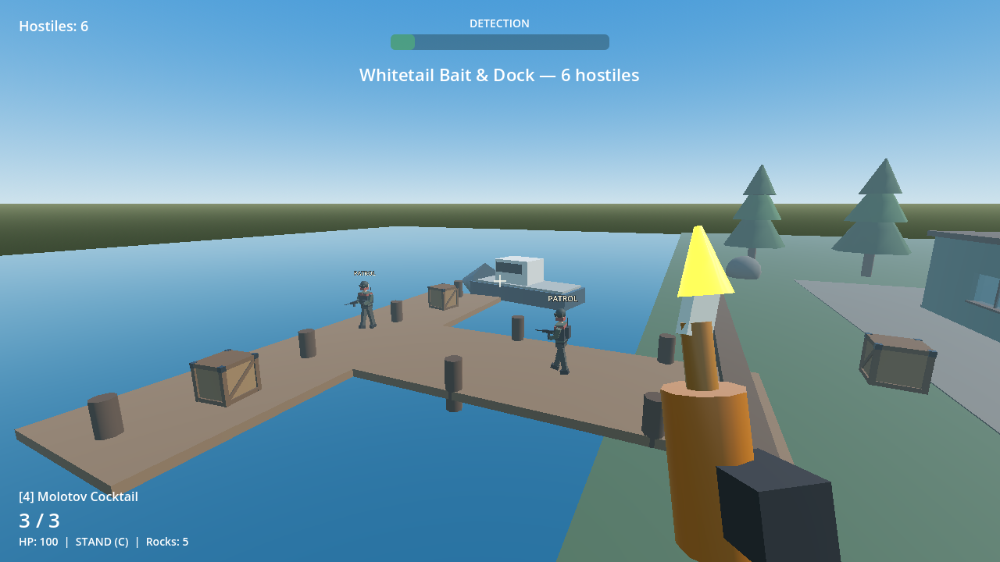
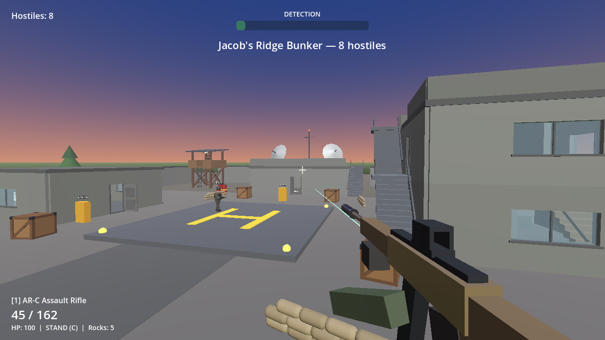

# Farsigh — Outpost Liberation

Godot **4.3** first-person stealth shooter inspired by Far Cry 5 outpost liberation. Pick an outpost on the Hope County map, customize a 5-slot loadout at the Gunsmith workbench, infiltrate multi-storey compounds, and liberate every outpost stealthily or loud. Runs on **PC** (Windows / Linux / macOS), **mobile** (Android / iOS), and in the **browser** with the **GL Compatibility** renderer and full touch controls.

## Play in browser

**[Play Farsigh](https://continuitydev.github.io/Farsigh/)** — no download required (GitHub Pages Web export, no threads so it works without COOP/COEP headers).

On desktop browsers: click the game once to capture the mouse. On phones: touch controls appear automatically.

## What's inside

### 5 Far Cry 5–Inspired Outposts & Map Select
- **Hope County Compound** (`compound_alpha`) — Militia supply depot with 2-storey HQ, watchtower, drive-in garage, 5 guards (1 sniper), 1 alarm.
- **Seed Family Ranch** (`ranch_redbarn`) — Golden-hour ranch compound with a 2-storey red barn, twin grain silos, 2-storey white farmhouse, hay cover, 6 guards (1 sniper), 2 alarms.
- **Baron Lumber Mill** (`lumber_mill`) — Pine forest sawmill with 2-storey saw hall, spinning saw deck, drying kiln, log stacks, twin towers, 7 guards (2 snipers), 2 alarms.
- **Whitetail Bait & Dock** (`river_dock`) — Riverside bait shop, L-shaped wooden pier, patrol boat, 2-storey boathouse, 6 guards (1 sniper), 1 alarm.
- **Jacob's Ridge Bunker** (`hilltop_bunker`) — Dusk hilltop fortress with a reinforced concrete bunker, walk-down underground bunker basement, radar dishes, helipad, 2-storey barracks, 8 guards (2 snipers), 2 alarms.
- Liberation saves per outpost (`user://outpost_save.json`) and resets on **New Run**.

### Multi-Storey Buildings & Runtime NavMesh
- Multi-room & multi-storey structures with interior partitions, stairs, reachable parapet rooftops, drive-in garages, an underground bunker basement, cutout see-through glass windows, and interactive hinged doors (`E` to toggle, guards auto-open them).
- Synchronous runtime `NavigationMesh` baking per outpost with `NavigationAgent3D` steering so guards patrol, investigate, and flank across rooms and floors.

### Animations & Player Movement
- **Guards**: front & back takedown animations, investigate, look-around, radio-call, and alarm-press animations with smooth `AnimationPlayer` cross-fading.
- **Player**: low-wall vaulting/climbing (`Space` near low cover), wall-safe lean/peek left & right (`Z` / `V`), weapon inspect (`I` / `T`), standing shoulder-carry & crouched body-drag viewmodel motion, and smooth ADS/sway/recoil transitions.

### Aim Down Sights (ADS)
- Hold Aim (RMB / LT / touch Aim) to raise the viewmodel from hip to sights — iron sights by default, or red dot / holo / scope when fitted in the Gunsmith.
- Per-weapon aim-in time, ADS FOV, tighter spread, lower recoil, slower movement, and reduced look sensitivity (adjustable in the pause menu).
- Scope overlay + breath-hold sway dampening for sniper / 4x scopes. Crosshair hides in ADS. Bow draw-and-aim, throwable lob arc preview, and melee ready stance included.

### 14-Weapon Arsenal & 5-Slot Gunsmith
- **Primary**: AR-C Assault Rifle, MP-40 / Vector SMG, M133 Pump Shotgun (8 pellets), MBP .50 Sniper Rifle (scope overlay), M60 LMG.
- **Secondary**: 1911 Tactical Pistol, Skorpion Machine Pistol.
- **Special / Bow**: Compound Bow, Tactical Crossbow.
- **Throwables**: Throwing Knives, M67 Frag Grenade, Molotov Cocktail (fire area-of-effect).
- **Melee**: Kukri Machete, Aluminum Bat.
- **Gunsmith mods** (visible on the 3D workbench preview and live first-person viewmodel, with stat deltas): Suppressor, Compensator, Red Dot, Holo Sight, 4x Scope, Extended Mag, Vertical Grip, Tactical Laser, Standard / Fire / Explosive arrows & bolts, and 6 weapon skins/finishes.
- Headshots are always one-shot with every weapon. Loadout and mods persist across sessions (`user://loadout_prefs.json`).

## How to run locally

1. Open this folder in Godot **4.3+** (`project.godot`).
2. Press **F5** (or Play). Main menu loads first.
3. Choose **New Run** or **Outpost Map** → open **Gunsmith & Loadout** → **Deploy**.

### Controls (PC)

| Action | Keyboard / Mouse | Gamepad |
|--------|------------------|---------|
| Move | WASD | Left stick |
| Look | Mouse | Right stick |
| Jump / Vault low wall | Space | A |
| Sprint | Shift | L3 |
| Crouch | Ctrl | B |
| Lean / Peek Left & Right | Z / V | — |
| Fire / Throw / Swing | LMB | RT / RB |
| Aim / ADS (iron, optic, or scope) | RMB hold | LT |
| Breath-hold (steady scope) | Shift while ADS | L3 while ADS |
| Reload | R | Y |
| Weapon inspect | I or T | — |
| Interact / door / body / alarm | E | X |
| Takedown (front or back) | F | R3 |
| Throw rock (distraction) | G | Select / Back |
| Switch weapon slot | 1–5 or Q | D-pad right |
| Drop carried body | X | — |
| Pause / Gunsmith shortcut | Esc | Start |

### Controls (Mobile / mobile browsers)

Touch controls appear automatically on native mobile and on web builds when a touchscreen is available (preview on desktop with `TOUCH_UI=1 godot --path .`):

- **Left virtual stick** — move
- **Right-side swipe** — look
- **Buttons** — `PEEK L`, `PEEK R`, `JUMP/VLT`, `CROUCH`, `SPRINT`, `FIRE`, `AIM`, `TAKEDOWN`, `ROCK`, `USE`, `INSPECT`, `SWAP`, `RELOAD`
- Pause menu: **ADS Sensitivity** (35–100%) and **Touch Aim Hold/Toggle**

## Screenshots

Captured from a running Godot 4.3 session (`AUTO_CAPTURE=1`):

| | |
|--|--|
| Hope County Outpost Select |  |
| 5-Slot Gunsmith & Live 3D Preview |  |
| Seed Family Ranch (Modded AR-C) |  |
| Baron Lumber Mill (Explosive Compound Bow) |  |
| Whitetail Bait & Dock (Molotov Cocktail) |  |
| Jacob's Ridge Bunker (Helipad & Radar) |  |
| Multi-Storey Interior Window & Weapon Inspect |  |
| Mobile Touch Controls & Kukri Machete |  |
| ADS Holo Sight (centered optic + FOV) |  |

```bash
# Automated screenshot capture (needs a display; use OpenGL if Vulkan is unavailable)
AUTO_CAPTURE=1 godot --path . --resolution 1280x720 --rendering-driver opengl3
```

## Exporting & GitHub Pages

Presets live in `export_presets.cfg` (including **Web** with `variant/thread_support=false` for GitHub Pages). Every push to `main` runs [`.github/workflows/deploy-web.yml`](.github/workflows/deploy-web.yml) to export and publish the Web build to `docs/`.

```bash
mkdir -p build/web
godot --headless --path . --export-release "Web" build/web/index.html
```

## License

Prototype code is free to use and extend for learning and game jams.
