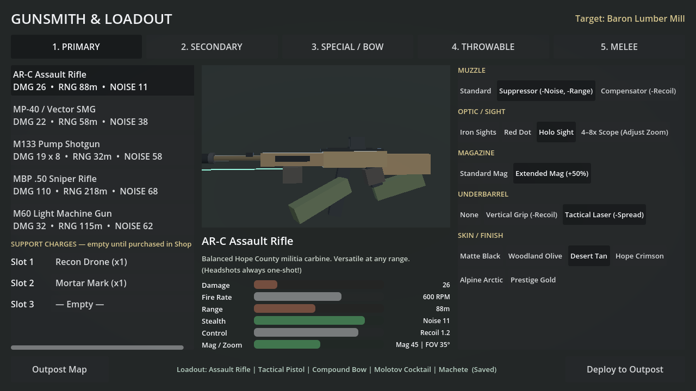
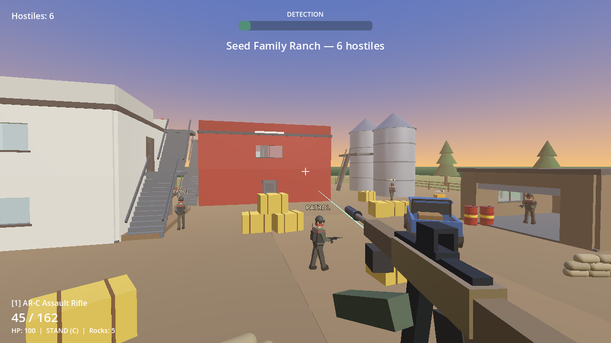
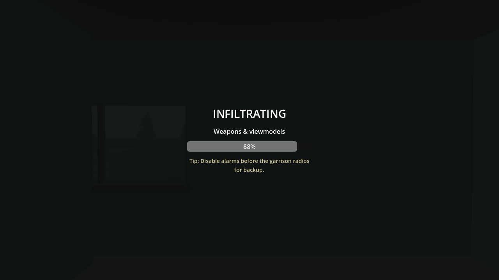
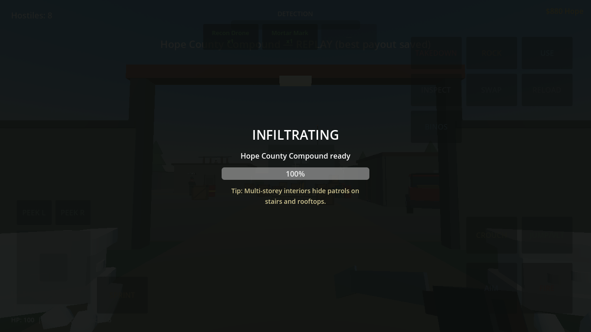
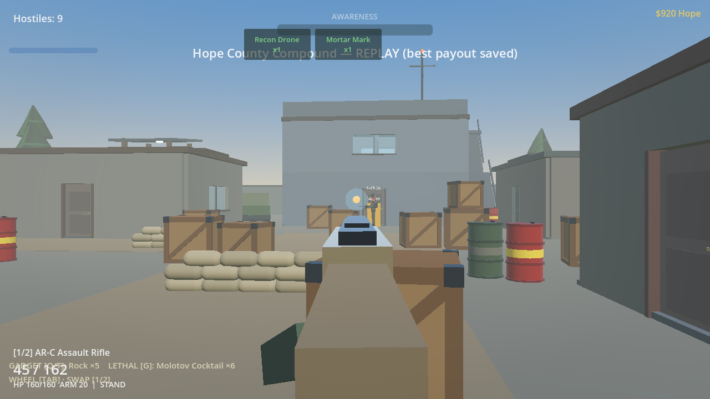
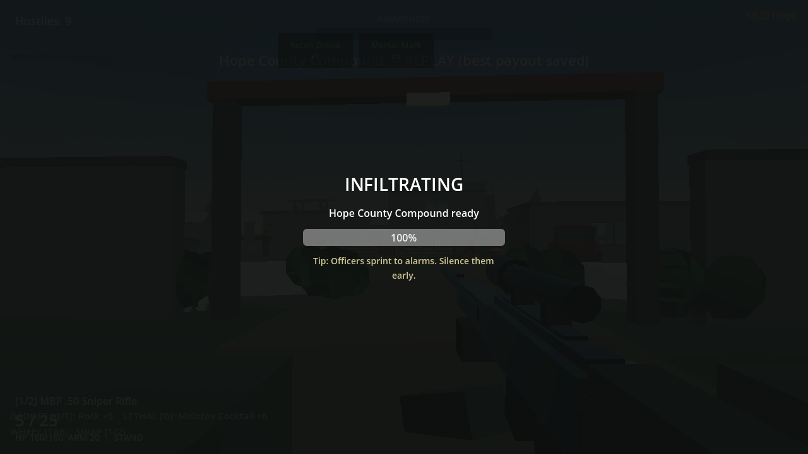
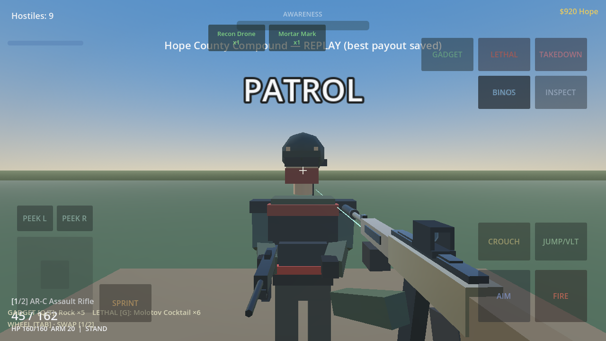
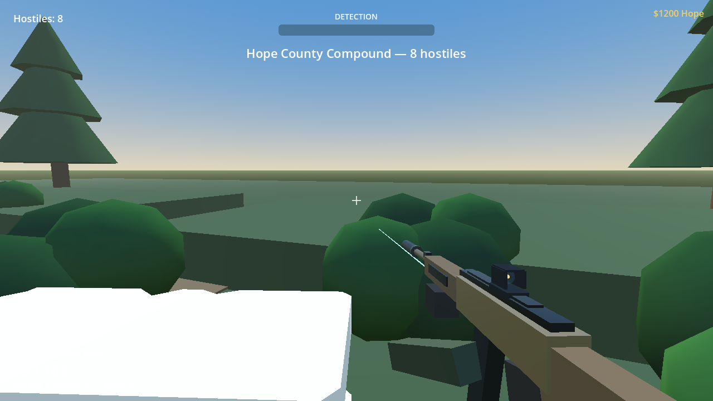
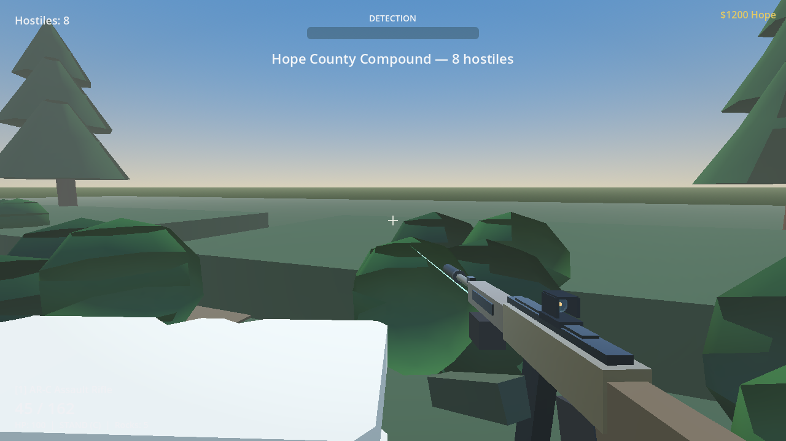
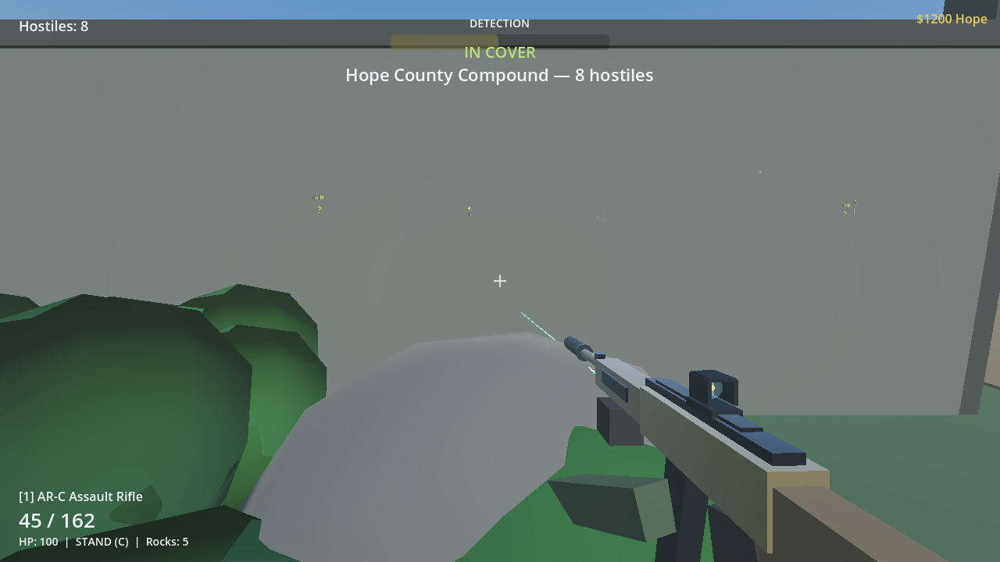

# Farsigh — Outpost Liberation

Godot **4.3** first-person stealth shooter inspired by Far Cry 5 outpost liberation. Pick an outpost on the Hope County map, customize a 5-slot loadout at the Gunsmith workbench, infiltrate multi-storey compounds, and liberate every outpost stealthily or loud. Runs on **PC** (Windows / Linux / macOS), **mobile** (Android / iOS), and in the **browser** with the **GL Compatibility** renderer and full touch controls.

## Play in browser

**[Play Farsigh](https://continuitydev.github.io/Farsigh/)** — no download required (GitHub Pages Web export, no threads so it works without COOP/COEP headers).

On desktop browsers: click the game once to capture the mouse. On phones: touch controls appear automatically.

## What's inside

### 8 Outposts (Standard → Boss) & Map Select
- **Hope County Compound** — Standard · 8 hostiles.
- **Seed Family Ranch** — Standard · 10 hostiles.
- **Baron Lumber Mill** — Standard · 10 hostiles.
- **Whitetail Bait & Dock** — Standard · 10 hostiles.
- **Jacob's Ridge Bunker** — Hard · 12 hostiles.
- **Eden's Gate Fortress** — Extreme · 13 hostiles · cameras, searchlights, tripwires, keycard doors (unlocks after Compound + Ranch).
- **Holland Valley Labour Camp** — Extreme · 12 hostiles · searchlights & cameras (unlocks after Mill + Dock).
- **Joseph's Cathedral HQ** — Boss · 12 hostiles · elite commander (unlocks after Ridge).
- Difficulty labels on Outpost Select; Hope Dollar clears scale with difficulty (Extreme/Boss pay more). Replay beaten compounds at 50% payout.
- Roles: **heavies**, **officers**, **commanders**, **dogs** + **handlers**, rooftop **snipers**, multi-storey **interior** patrols.
- AI LOD + staged loading screen keep mobile WebGL workable.
- **Hope Dollars** shop: weapons, items, and **buyable consumable supports** (Recon Drone, Mortar, Fangs, EMP, Overwatch, Gunship). Charges save to profile; New Run starts at zero. Free binoculars tagging (+ Pro upgrade in shop).
- Liberation saves per outpost (`user://outpost_save.json`) and resets on **New Run**.

### Multi-Storey Buildings & Runtime NavMesh
- Multi-room & multi-storey structures with interior partitions, stairs, reachable parapet rooftops, drive-in garages, an underground bunker basement, cutout see-through glass windows, and interactive hinged doors (`E` to toggle, guards auto-open them).
- Synchronous runtime `NavigationMesh` baking per outpost with `NavigationAgent3D` steering so guards patrol, investigate, and flank across rooms and floors.

### Animations & Player Movement
- **Guards**: front & back takedown animations, investigate, look-around, radio-call, and alarm-press animations with smooth `AnimationPlayer` cross-fading.
- **Player**: low-wall vaulting/climbing (`Space` near low cover), wall-safe lean/peek left & right (`Z` / `V`), weapon inspect (`I` / `T`), standing shoulder-carry & crouched body-drag viewmodel motion, and smooth ADS/sway/recoil transitions.

### Aim Down Sights (ADS)
- Hold Aim (RMB / LT / touch Aim) to raise the viewmodel from hip to sights — iron sights by default, or red dot / holo / scope when fitted in the Gunsmith.
- True optic zoom vs hip FOV 70°: **red dot 1.5×** (~46.7°), **holo 2×** (35°), **scope 4×** (17.5°) with sniper Adjust Zoom cycling **4× → 6× → 8×** (mouse wheel / `N` on PC; touch **ZOOM** while ADS).
- Scope overlay + breath-hold sway dampening for magnified scopes. Crosshair hides in ADS. Gunsmith optic choice persists into the field.
- Mobile touch actions are contextual: Takedown / Reload / Use / Rock / ZOOM / Binos only show when usable (no dead buttons).

### 14-Weapon Arsenal & 5-Slot Gunsmith
- **Primary**: AR-C Assault Rifle, MP-40 / Vector SMG, M133 Pump Shotgun (8 pellets), MBP .50 Sniper Rifle (scope overlay), M60 LMG.
- **Secondary**: 1911 Tactical Pistol, Skorpion Machine Pistol.
- **Special / Bow**: Compound Bow, Tactical Crossbow.
- **Throwables**: Throwing Knives, M67 Frag Grenade, Molotov Cocktail (fire area-of-effect).
- **Melee**: Kukri Machete, Aluminum Bat.
- **Gunsmith mods** (visible on the 3D workbench preview and live first-person viewmodel, with stat deltas): Suppressor, Compensator, Red Dot, Holo Sight, 4x Scope, Extended Mag, Vertical Grip, Tactical Laser, Standard / Fire / Explosive arrows & bolts, and 6 weapon skins/finishes.
- Headshots are always one-shot with every weapon. Loadout and mods persist across sessions (`user://loadout_prefs.json`).

## How to run locally

1. Open this folder in Godot **4.3+** (`project.godot`).
2. Press **F5** (or Play). Main menu loads first.
3. Choose **New Run** or **Outpost Map** → open **Gunsmith & Loadout** → **Deploy**.

### Controls (PC)

| Action | Keyboard / Mouse | Gamepad |
|--------|------------------|---------|
| Move | WASD | Left stick |
| Look | Mouse | Right stick |
| Jump / Vault low wall | Space | A |
| Sprint | Shift | L3 |
| Crouch | Ctrl | B |
| Lean / Peek Left & Right | Z / V | — |
| Fire / Throw / Swing | LMB | RT / RB |
| Aim / ADS (iron, optic, or scope) | RMB hold | LT |
| Adjust Zoom (sniper 4/6/8×) | Mouse wheel or N while ADS | — |
| Breath-hold (steady scope) | Shift while ADS | L3 while ADS |
| Reload | R | Y |
| Weapon inspect | I or T | — |
| Interact / door / body / alarm | E | X |
| Takedown (front or back) | F | R3 |
| Throw rock (distraction) | G | Select / Back |
| Switch weapon slot | 1–5 or Q | D-pad right |
| Drop carried body | X | — |
| Pause / Gunsmith shortcut | Esc | Start |

### Controls (Mobile / mobile browsers)

Touch controls appear automatically on native mobile and on web builds when a touchscreen is available (preview on desktop with `TOUCH_UI=1 godot --path .`):

- **Left virtual stick** — move
- **Right-side swipe** — look
- **Always-on** — move stick, look, `FIRE`, `AIM`, `JUMP/VLT`, `CROUCH`, `SPRINT`, `PEEK L/R`, `SWAP`
- **Contextual** — `TAKEDOWN` (enemy in range), `RELOAD` (mag not full + reserve), `USE` (interactable/body), `ROCK` (rocks left), `ZOOM` (ADS + variable scope), `BINOS` (hidden while ADS), `INSPECT`
- **Settings** (main menu + pause): separate **Mouse Look** / **Touch Look** sliders with live %, **ADS/Scope** multiplier, optional **4×/6×/8×** scope mults, **Invert Y**, graphics quality, Touch Aim Hold/Toggle, Tap-to-Fire, Fullscreen. Saved to `user://loadout_prefs.json` and applied live.
- Look-swipes never fire — mouse-from-touch stays on so menus/gunsmith respond to taps, but fire/aim ignore mouse while the touch UI is up; only the on-screen **FIRE** button shoots (PC LMB unchanged)
- **BINOS** stays tappable while raised (toggle down); pinch or overlay **±** zoom; PC **B** + wheel still work
- Per-guard **?** / **!** awareness meters; hearing → investigate only (never instant spot); delayed interruptible shout/radio (~1.5–3s)
- Crouch in bushes/tall grass → HUD **HIDDEN**; MultiMesh foliage + wind/water/rim shaders on Medium/High quality


## Screenshots

Captured from a running Godot 4.3 session (`AUTO_CAPTURE=1`):

| | |
|--|--|
| Hope County Outpost Select |  |
| 5-Slot Gunsmith & Live 3D Preview |  |
| Seed Family Ranch (Modded AR-C) |  |
| Baron Lumber Mill (Explosive Compound Bow) |  |
| Whitetail Bait & Dock (Molotov Cocktail) |  |
| Jacob's Ridge Bunker (Helipad & Radar) |  |
| Multi-Storey Interior Window & Weapon Inspect |  |
| Mobile Touch Controls & Kukri Machete |  |
| ADS Holo Sight (2×) |  |
| ADS Red Dot (1.5×) |  |
| ADS Iron Sights |  |
| Sniper Scope 4× |  |
| Sniper Scope 8× |  |
| Mobile HUD (decluttered) |  |
| Mobile HUD + Takedown |  |
| Quality Before (Low) |  |
| Quality After (High) |  |
| Gun Detail + Rim (High) |  |
| Per-Guard Alert Meters |  |
| Foliage Hide / HIDDEN HUD |  |
| Water Shader (High) |  |

```bash
# Automated screenshot capture (needs a display; use OpenGL if Vulkan is unavailable)
AUTO_CAPTURE=1 godot --path . --resolution 1280x720 --rendering-driver opengl3
```

## Exporting & GitHub Pages

Presets live in `export_presets.cfg` (including **Web** with `variant/thread_support=false` for GitHub Pages). Every push to `main` runs [`.github/workflows/deploy-web.yml`](.github/workflows/deploy-web.yml) to export and publish the Web build to `docs/`.

```bash
mkdir -p build/web
godot --headless --path . --export-release "Web" build/web/index.html
```

## License

Prototype code is free to use and extend for learning and game jams.

## Garrison sizes

| Outpost | Hostiles | Difficulty |
|---|---|---|
| Hope County Compound | 8 | Standard |
| Seed Family Ranch | 10 | Standard |
| Baron Lumber Mill | 10 | Standard |
| Whitetail Dock | 10 | Standard |
| Jacob's Ridge Bunker | 12 | Hard |
| Eden's Gate Fortress | 13 | Extreme (locked) |
| Labour Camp | 12 | Extreme (locked) |
| Joseph's Cathedral HQ | 12 | Boss (locked) |
