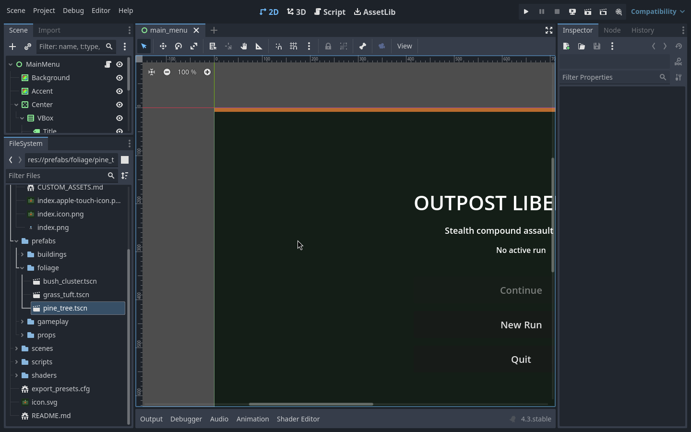

# Custom assets and the prefab library

Every reusable map piece is a Godot scene you can drag from the FileSystem dock into a compound. The compounds themselves are scenes, not something that only exists after the game starts.



## Where things live

| Folder | What you drop |
|---|---|
| `res://prefabs/buildings/` | Shacks, HQ, garage, watchtower, chain-link fence run, gate, silo, windmill, radar, light pole, floodlight, overlook nest |
| `res://prefabs/characters/` | Guard humanoid. The militia mesh, gear, and clips are built when the scene runs |
| `res://prefabs/props/` | Crate, sandbags, barrels, trucks, boulder, jersey barrier, hay bale, log pile, patrol boat |
| `res://prefabs/foliage/` | Pine, bush cluster (with a hide zone), grass tuft |
| `res://prefabs/gameplay/` | Guard spawn, patrol point, entrance, cover point |
| `res://scenes/compounds/` | One editable scene per outpost |

Open `scenes/compounds/compound_alpha.tscn` (or any other outpost id) and you are editing the map the game loads. Save, then play. You do not need to run a baker again unless you want to regenerate the library from the procedural builders.

Regenerate everything from the current builders with:

```bash
BAKE_COMPOUNDS=1 godot --headless --path .
```

## Drag, drop, play

1. Open the project in Godot 4.3.
2. In the FileSystem dock, open `prefabs/` and the category you want.
3. Drag the `.tscn` into an open compound scene, or copy and paste it.
4. Move it. The root sits on the ground (pivot at the base, 1 unit = 1 metre). Scale the root if you need a bigger crate, tree, or boulder. The chain-link fence is a 4 m run; scale X to lengthen it. Do not scale Y or it stops being a fence.
5. Save the compound. The next time that outpost loads, the new piece is there.

What happens on its own:

- **Collision.** Prefabs already have a `StaticBody3D`. The navmesh bake on outpost load reads those colliders, so a wall you just dropped blocks guards after you play.
- **Hiding.** Bush clusters include a `FoliageHideZone`. Crouching inside it hides the player.
- **AI cover.** Crates, sandbags, trucks, and boulders carry a yellow `CoverPoint` marker. Guards use the `cover_points` group. A bare `prefabs/gameplay/cover_point.tscn` adds another spot.
- **Lights.** Floodlights and yard poles are in the `compound_lights` group. Night turns them on. The day/night sky is unchanged.
- **Guard routes.** Each `GuardSpawn` marker is one hostile. Its child `PatrolPoint` markers are the route, in local space, so moving the spawn moves the loop with it. Select the spawn and set `role` (`patrol`, `sniper`, `heavy`, `officer`, `handler`, `dog`, `interior`, `commander`), `sniper`, `sentry`, and `dog_id` in the Inspector. `entrance.tscn` marks a way in. Editor spheres (the coloured gizmos) hide while the game is running.

If a compound scene has any `GuardSpawn` markers, those replace the catalog list for that outpost. Delete a marker to remove that guard.

## Your own mesh

Export glTF from Blender at **1 unit = 1 metre**, Y up, pivot at the base. Drop the `.glb` into the compound (or under `assets/custom/` and then instance it). Name the node so the loader can finish it:

| Name contains | Result |
|---|---|
| `_col` | Triangle-mesh collision if the mesh does not already have a `StaticBody3D` |
| `_hide` | A hide volume on that node |
| `_cover` | Added to `cover_points` |

Example: `crate_col`, `bush_hide`, `rock_cover`. Textures for the web build should be **512×512** (1024 only if the surface is huge), JPG or PNG, with mipmaps left on. Ground textures already in `assets/textures/ground/` are 512² CC0 maps from ambientCG; see `assets/licenses/AMBIENTCG.md`.

The terrain shader samples those maps in world space (grass, dirt, mud, gravel, worn path) with a height blend and a second octave so the tiling does not read as a grid. Grass cards sit along path edges. Scaling a ground slab does not stretch the texture.

## Night

Do not retune `scripts/systems/day_night_cycle.gd` or `shaders/sky_cycle.gdshader` when you add a prop. New lights join the existing night group; the sky stays as it is.
